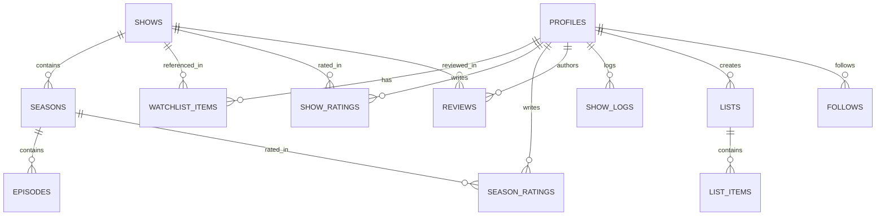

# AfterCredits — Engineering Plan & Product Architecture

> **Tagline:** "Your TV life, documented."  
> **Mission:** Build the definitive social platform for television enthusiasts — inspired by Letterboxd, purpose-built for the unique rhythms of episodic and seasonal television.

---

## 1. Executive Summary & Core Value Proposition

Television is fundamentally different from cinema:
- TV viewing happens over seasons, hiatuses, and years rather than a 2-hour sitting.
- Shows change dramatically between seasons (e.g., *True Detective* Season 1 vs Season 2, *Game of Thrones* early vs late seasons).
- Spoilers are seasonal and episodic; discussing an ongoing season requires airtight spoiler controls.
- Community discourse revolves around seasonal rankings, episode reactions, and status tracking (watching, want to watch, completed, paused, dropped).

**AfterCredits** delivers:
1. **Season-specific ratings & personal rankings:** Rate individual seasons independently of the parent show, and rank seasons within or across shows.
2. **Spoiler-safe reviews & discussion:** Granular season/episode tagging with hardened spoiler shrouds.
3. **Frictionless tracking:** Quick status updates (Want to Watch, Watching, Completed, On Hold, Dropped) with season progress counters.
4. **Social discovery:** Activity feed showing friends' ratings, reviews, diary logs, and curated lists.

---

## 2. Technical Stack & Architectural Decisions

| Layer | Technology | Rationale |
|---|---|---|
| **Framework** | **Next.js 15 (App Router)** | Server Components for SEO-friendly show pages, Streaming SSR for fast TTFB, Route Handlers for TMDB proxies |
| **Language** | **TypeScript (Strict Mode)** | End-to-end type safety across TMDB models, Supabase entities, and UI state |
| **Styling** | **Tailwind CSS** + **shadcn/ui** | Rapid component composition with a custom cinematic dark theme |
| **Icons** | **Lucide React** | Lightweight, tree-shakeable icons matching cinema aesthetic |
| **Database & Auth** | **Supabase (PostgreSQL 15+)** | Auth (Email + OAuth), Row Level Security (RLS) for zero-trust data access, real-time potential |
| **External Catalog** | **The Movie Database (TMDB) API** | Canonical source for TV show, season, episode, cast, and high-res poster/backdrop metadata |
| **Deployment** | **Vercel** / Edge-ready | Zero-config preview branches, edge caching for TMDB proxy routes |

### Credential Safety & Architecture Boundary
- **Never expose secrets to client:** TMDB API key and Supabase Service Role key are strictly server-side.
- TMDB requests are routed through `/api/tmdb/[...path]` or executed inside Next.js Server Actions / Server Components with response caching (`fetch(..., { next: { revalidate: 3600 } })`).
- If TMDB or Supabase credentials are missing, the system detects this and falls back to a realistic **offline demo mode with mock data** so development and UI testing are never blocked.

---

## 3. Database Schema & Row Level Security (RLS)

A normalized PostgreSQL schema ensuring data integrity, foreign key cascades, and performant indexes.

### Table Specifications

1. **`profiles`**
   - `id` (UUID, PK, references `auth.users.id` on delete cascade)
   - `username` (text, unique, 3-24 chars, alphanumeric + underscores)
   - `display_name` (text, max 50 chars)
   - `bio` (text, max 300 chars)
   - `avatar_url` (text)
   - `header_backdrop_url` (text)
   - `created_at`, `updated_at` (timestamptz)

2. **`shows`** (Cached catalogue entries)
   - `id` (bigint, PK — matches TMDB TV show ID)
   - `name` (text, not null)
   - `original_name` (text)
   - `overview` (text)
   - `poster_path` (text)
   - `backdrop_path` (text)
   - `first_air_date` (date)
   - `last_air_date` (date)
   - `status` (text: Returning Series, Ended, Canceled)
   - `number_of_seasons` (int)
   - `number_of_episodes` (int)
   - `vote_average` (numeric(3,1))
   - `genres` (jsonb)
   - `updated_at` (timestamptz)

3. **`seasons`**
   - `id` (bigint, PK — matches TMDB Season ID)
   - `show_id` (bigint, references `shows.id` on delete cascade)
   - `season_number` (int, not null)
   - `name` (text)
   - `overview` (text)
   - `poster_path` (text)
   - `air_date` (date)
   - `episode_count` (int)
   - Unique constraint: `(show_id, season_number)`

4. **`watchlist_items`**
   - `id` (UUID, PK, default `gen_random_uuid()`)
   - `user_id` (UUID, references `profiles.id` on delete cascade)
   - `show_id` (bigint, references `shows.id` on delete cascade)
   - `status` (enum: `want_to_watch`, `watching`, `completed`, `on_hold`, `dropped`)
   - `current_season` (int, default 1)
   - `current_episode` (int, default 0)
   - `created_at`, `updated_at` (timestamptz)
   - Unique constraint: `(user_id, show_id)`

5. **`show_ratings`**
   - `id` (UUID, PK)
   - `user_id` (UUID, references `profiles.id` on delete cascade)
   - `show_id` (bigint, references `shows.id` on delete cascade)
   - `rating` (numeric(2,1), check: 0.5 to 5.0 step 0.5)
   - `created_at`, `updated_at` (timestamptz)
   - Unique constraint: `(user_id, show_id)`

6. **`season_ratings`**
   - `id` (UUID, PK)
   - `user_id` (UUID, references `profiles.id` on delete cascade)
   - `show_id` (bigint, references `shows.id` on delete cascade)
   - `season_id` (bigint, references `seasons.id` on delete cascade)
   - `season_number` (int, not null)
   - `rating` (numeric(2,1), check: 0.5 to 5.0 step 0.5)
   - `personal_rank` (int, nullable — e.g. Rank 1 of 5 seasons of this show)
   - `created_at`, `updated_at` (timestamptz)
   - Unique constraint: `(user_id, season_id)`

7. **`reviews`**
   - `id` (UUID, PK)
   - `user_id` (UUID, references `profiles.id` on delete cascade)
   - `show_id` (bigint, references `shows.id` on delete cascade)
   - `season_id` (bigint, nullable, references `seasons.id` on delete cascade)
   - `rating` (numeric(2,1), nullable)
   - `content` (text, not null)
   - `has_spoilers` (boolean, default false)
   - `spoilers_up_to_season` (int, nullable)
   - `spoilers_up_to_episode` (int, nullable)
   - `created_at`, `updated_at` (timestamptz)

8. **`follows`**
   - `follower_id` (UUID, references `profiles.id` on delete cascade)
   - `following_id` (UUID, references `profiles.id` on delete cascade)
   - `created_at` (timestamptz)
   - PK: `(follower_id, following_id)`, check `follower_id <> following_id`

9. **`review_likes`**
   - `user_id` (UUID, references `profiles.id` on delete cascade)
   - `review_id` (UUID, references `reviews.id` on delete cascade)
   - `created_at` (timestamptz)
   - PK: `(user_id, review_id)`

10. **`lists` & `list_items`**
    - `lists`: `id`, `user_id`, `title`, `description`, `is_ranked` (bool), `is_private` (bool), timestamps
    - `list_items`: `id`, `list_id`, `show_id`, `season_id` (nullable), `position` (int), `notes` (text)

11. **`activities`** (Fan-out or queryable audit feed)
    - `id`, `user_id`, `activity_type` (`rating`, `review`, `watchlist_change`, `list_created`), `target_id`, `metadata` (jsonb), `created_at`

### RLS Policies
- **`profiles`**: Public read. Update allowed only where `auth.uid() = id`.
- **`watchlist_items`**: Public read for public profiles. Insert/Update/Delete only where `auth.uid() = user_id`.
- **`reviews`**: Public read. Insert/Update/Delete only where `auth.uid() = user_id`.
- **`shows` / `seasons`**: Public read. Insert/Update via authenticated service or server action on lookup.
- **`follows`**: Public read. Insert/Delete only where `auth.uid() = follower_id`.

---

## 4. Design & Visual Identity

### Color Palette (Cinematic Darkroom)
- **Backgrounds**:
  - `bg-cinema-base`: `#090a0f` (Deepest onyx, near-black)
  - `bg-cinema-surface`: `#11131a` (Dark charcoal card base)
  - `bg-cinema-elevated`: `#191c26` (Floating modals, tooltips, dropdowns)
  - `border-cinema-subtle`: `rgba(255, 255, 255, 0.08)`
- **Accents**:
  - `accent-crimson`: `#e11d48` (Primary CTA, glowing badge, active states)
  - `accent-burgundy`: `#881337` (Secondary pill, subtle gradient mesh)
  - `accent-amber`: `#f59e0b` (Star ratings, badges)
- **Typography & Warm Whites**:
  - `text-cinema-primary`: `#f4f4f6` (Warm crisp white)
  - `text-cinema-secondary`: `#9ca3af` (Muted silver)
  - `text-cinema-tertiary`: `#6b7280` (Dark gray metadata)

### Visual Principles
- **No cheap generic dashboard look:** No pastel corporate SaaS colors. Feels like walking into an IMAX private lounge.
- **Cinematic artwork focus:** Large 16:9 backdrop banners with radial vignette overlays, high-fidelity 2:3 aspect poster cards.
- **Restrained micro-interactions:** Subtle 200ms ease-out poster card scale (`scale-[1.03]`), border luminosity on hover.
- **Spoiler shrouds:** Blurred overlay with red warning tag and explicit "Reveal Spoiler" button.

---

## 5. Application Route Map

| Path | Purpose | State / Data Requirements |
|---|---|---|
| `/` | Landing / Hero showcase | Featured trending shows, latest popular reviews, CTA to sign up |
| `/discover` | Search & Browse catalog | Live search bar, genre filter pills, air year filters, TMDB grid |
| `/show/[id]` | Show detail page | Backdrop hero, metadata, season selector, cast, friend activity, user status modal |
| `/show/[id]/season/[num]` | Season detail & rankings | Season episodes list, season rating widget, personal season ranker |
| `/feed` | Social activity feed | Friend ratings, reviews, diary entries chronologically |
| `/diary` | Viewing log / calendar | Chronological list of logged episodes/shows with timestamps |
| `/watchlist` | User's saved shows | Grouped by status tabs (Watching, Want to Watch, Completed, etc.) |
| `/u/[username]` | Public profile | Bio, favorite 4 shows, stats (hours watched, shows completed), recent activity |
| `/u/[username]/reviews` | User reviews archive | Filterable by show, rating, and date |
| `/u/[username]/lists` | User created lists | Ranked or unranked show collections |
| `/list/[id]` | Individual list view | Grid or numbered list with curator notes |
| `/login` & `/signup` | Authentication | Clean modal/page with email/pass and social login |
| `/settings` | Profile & Preferences | Username, avatar, spoiler filter sensitivity, TMDB connection |

---

## 6. Implementation Milestones

### Milestone 1: Foundation & Vertical Slice 1 (Current Session)
- [x] Workspace inspection and Git preparation (`.gitignore`, `.env.example`).
- [ ] Initialize Next.js App Router with TypeScript strict mode, Tailwind CSS, Lucide icons.
- [ ] Implement Cinematic Dark Design System (colors, fonts, layout shell with responsive Nav and Footer).
- [ ] Supabase client architecture (browser client, server client, middleware ready).
- [ ] TMDB API integration service layer with mock fallback data when API keys are absent.
- [ ] Complete Vertical Slice 1:
  - Working Application Shell.
  - Interactive Search on `/discover` with TMDB / mock fallback.
  - Show detail page at `/show/[id]` with real poster/backdrop, seasons list, and cast.
  - Working Watchlist state manager (persists to Supabase or structured localStorage session for instant preview).
  - Add/Remove from Watchlist with status selection (Want to Watch, Watching, Completed).
  - Verify persistence across browser reloads.

### Milestone 2: Authentication & Profiles
- Supabase Auth integration (email/password signup, login, session refresh).
- Auto-provisioning `profiles` row upon signup via PostgreSQL trigger.
- User profile page `/u/[username]` with stats summary and favorite 4 shows.
- Profile settings to update avatar, bio, and display name.

### Milestone 3: Ratings, Reviews & Spoiler Safeguards
- Half-star (0.5 to 5.0) rating component with interactive hover.
- Modal for writing and editing reviews with title, body, and spoiler toggle.
- Season-specific rating drawer and personal ranking mechanism.
- Concealed spoiler shrouds in feeds and review lists.

### Milestone 4: Social Graph & Activity Feed
- Follow / unfollow functionality with RLS security.
- Global & friend-only activity feed at `/feed`.
- Like reviews with optimistic UI updates.

### Milestone 5: Lists & Diary
- Curated list builder (drag-and-drop or numbered reordering).
- Diary logging component for tracking what was watched on specific dates.

### Milestone 6: Polish, Testing & Deployment
- Mobile responsive audit (drawer navigation, touch-friendly tap targets).
- Full TypeScript and production build validation.
- TMDB attribution and legal compliance footer.
- Vercel deployment configuration.

---

## 7. Missing Credentials & Setup Guide

To run AfterCredits with live external cloud services:

### 1. The Movie Database (TMDB) API
- **Variable:** `TMDB_API_KEY` (or `TMDB_READ_ACCESS_TOKEN`)
- **How to obtain:**
  1. Create a free account at [themoviedb.org](https://www.themoviedb.org/).
  2. Navigate to Settings -> API -> Request an API Key (Developer).
  3. Copy your API Key (v3 auth) or API Read Access Token (v4 auth).
  4. Paste into `.env.local`: `TMDB_API_KEY=your_key_here`.

### 2. Supabase Project
- **Variables:**
  - `NEXT_PUBLIC_SUPABASE_URL=https://your-project.supabase.co`
  - `NEXT_PUBLIC_SUPABASE_ANON_KEY=your-anon-key`
  - `SUPABASE_SERVICE_ROLE_KEY=your-service-role-key` (server-side only)
- **How to obtain:**
  1. Create a project at [supabase.com](https://supabase.com/).
  2. Under Project Settings -> API, copy Project URL and `anon public` key.
  3. Run the SQL schema script provided in `supabase/schema.sql` in the Supabase SQL Editor.

*(Note: In Milestone 1, AfterCredits includes high-fidelity fallback data and local storage persistence so the app can be run, interacted with, and tested immediately even before credentials are input).*

---

## 8. Acceptance Criteria for Vertical Slice 1
1. `npm run dev` boots cleanly without errors or hydration warnings.
2. Visiting `http://localhost:3000` renders the cinematic dark landing page with featured TV shows and navigation.
3. Visiting `/discover` enables real-time search with visual poster cards, ratings, and genre tags.
4. Clicking any show opens `/show/[id]` with full synopsis, season list, and "Add to Watchlist" control.
5. Changing status (e.g., to "Watching" or "Want to Watch") updates the button state and saves to persistent storage.
6. Refreshing the browser preserves the saved watchlist state.
7. Visiting `/watchlist` lists the saved shows with their respective statuses.
8. TypeScript strict compilation and production build (`npm run build`) pass with zero errors.
